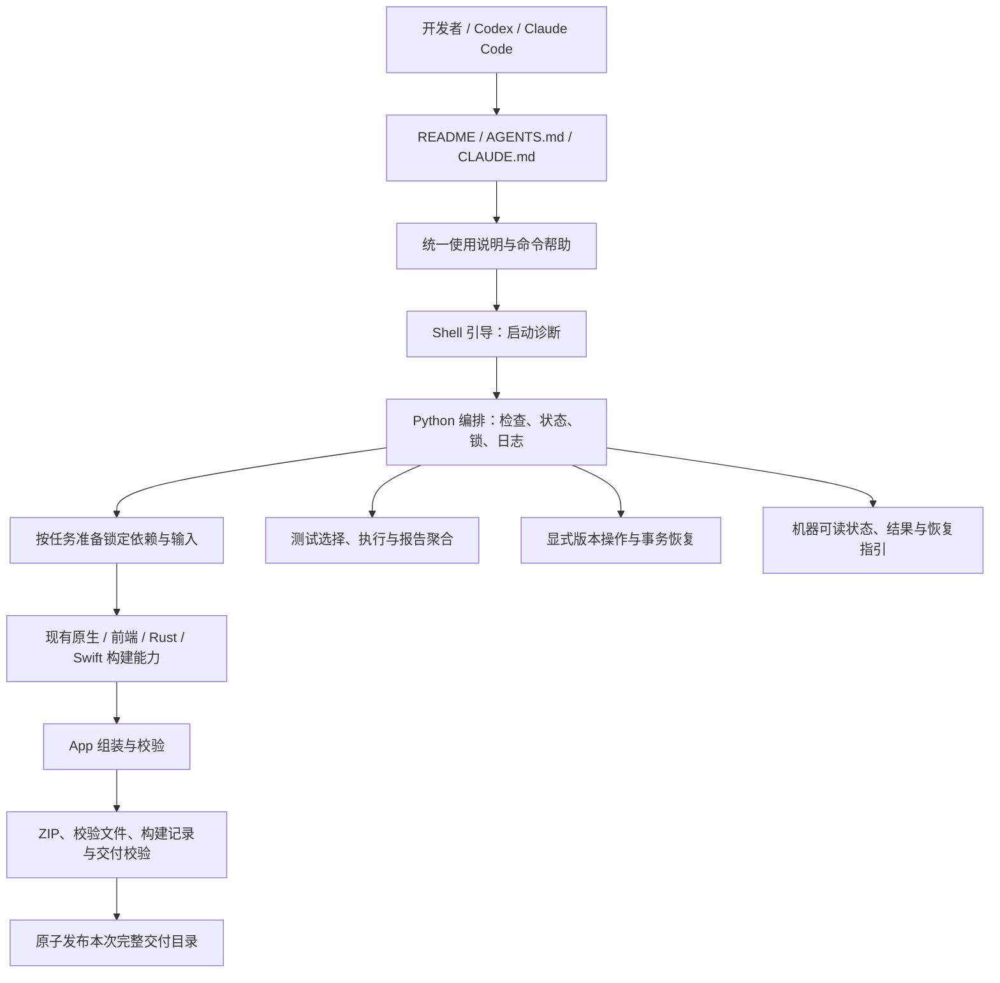

# 统一开发工具与一键开发出包——技术设计

> 创建日期：2026-10-11
> 状态：用户已指示基于本设计制定开发计划；作为路线图依据，实施尚未启动。
> 前置文档：[已确认的需求分析](requirement_analysis.md)。本文设计 macOS Apple Silicon 默认开发路径的检查、构建、测试、出包及版本维护；对应计划见[开发路线图](requirement_road_map.md)。

## 设计目标与非目标

将现有多步流程封装为一个可由开发者和 Agent 使用的命令。入口先检查已有工具，检查通过后准备锁定项目依赖、从当前 checkout 构建，并交付 App、ZIP、SHA-256 和构建记录。失败和中断同样有可识别的状态与恢复指引。

设计覆盖 G1～G12、FR-01～FR-15。工具安装、签名公证、公开发布、人工桌面与付费 provider 验收及其他平台均沿用需求文档的非目标。构建、测试与出包不改业务源码、锁文件、全局工具配置或系统授权；显式版本维护仅修改声明版本文件及必要本地锁条目；不查找其他项目目录的依赖与制品。

同一入口提供独立子命令，按所选任务准备必需环境与依赖。完整出包仍自动包含必要构建，自动化测试与版本更新由显式命令触发，不隐式并入出包。

## 上下文与现状

| 现有能力 | 复用方式 | 需要补强的边界 |
| --- | --- | --- |
| `scripts/doctor.py` | 保留旧入口，提取共用只读检查逻辑 | Python 缺失时的引导、完整工具要求、结构化诊断 |
| `scripts/sherpa/fetch-inputs.py` | 获取锁定源码、子模块、归档和模型 | 统一日志、错误分类、自有临时状态恢复 |
| `scripts/sherpa/reproducible-build.py` | 保留严格工具链及可复现构建检查 | 将检查证据纳入构建记录 |
| `scripts/build.sh` | 复用编译与准备能力，旧命令继续可用 | 新入口负责阶段顺序，避免重复完整编译 |
| `scripts/macos/build-dev-app.sh` | 保留资源、架构、动态库和许可证校验及 App staging | 接收已经验证的本次构建输出，扩展到完整交付目录发布 |
| Sherpa 与 FFmpeg 构建脚本 | 保留源码构建、许可证材料与既有验证 | staging 构建、完成凭据、异常退出后不复用半成品 |
| 前端、Cargo、Swift 锁文件 | 作为依赖解析依据 | 全链路禁止隐式更新锁文件 |

现有能力已经证明本机可出包，尚未覆盖新 clone、工具缺失、并发、中断恢复和跨 Agent 自主发现。现有前端已提供 Vitest 和类型检查，Rust 采用 workspace 测试；独立 `tests/api_regression` 提供 quick/acceptance、隔离测试宿主、真实本地 ASR 与安全报告。前端 package.json 没有应用版本字段，应用版本目前分别见于 Tauri 配置、桌面 Cargo manifest 和打包 Info.plist。

新设计以编排与补强为主，不重写应用架构，也不改变业务 API、proto 或应用数据存储。

## 方案选择与取舍

| 方案 | 优点 | 代价或风险 | 结论 |
| --- | --- | --- | --- |
| 单个大型 Shell 脚本 | 启动要求低 | 状态、JSON、恢复和子进程管理难维护 | Shell 只负责引导 |
| Node 编排 | 前端生态熟悉 | Node 缺失或不兼容时入口无法诊断 | 不采用 |
| Shell 引导 + Python 标准库编排 | 缺 Python 也能提示；结构化状态和测试方便；现有脚本已依赖 Python | 需要明确两层职责 | 采用 |
| 增加专用 Agent 插件或 MCP 服务 | 可提供专属调用界面 | 新开发者必须额外安装，跨工具维护成本高 | 不作为 MVP 前提 |

Shell 引导 + Python 标准库编排方案已获用户确认。按用户补充意见，统一入口和开发出包相关实现集中放在 `scripts/dev_package/`，公开入口为 `./scripts/dev_package/dev-package.sh`，不在 `scripts/` 根目录另设新入口。

建议目录如下，表示职责划分，具体模块可在实现时按规模合并：

```text
scripts/dev_package/
  dev-package.sh       # 唯一公开 Shell 入口
  __main__.py          # Python 命令解析与编排启动
  checks.py            # 环境与输入检查
  pipeline.py          # 阶段编排及现有能力适配
  state.py             # 状态、结果、事件和协议
  process.py           # 仓库锁与受控子进程
  recovery.py          # 自有临时状态识别与恢复
  delivery.py          # 交付验证与原子发布
  testing.py           # 测试范围、执行和下层结果聚合
  versioning.py        # 版本清单、修改预览和事务恢复
  phases/              # 出包专用的下载、构建、组装脚本
  tests/               # 编排、协议与故障恢复测试
  README.md            # 目录职责与统一说明入口
```

开发出包专用的现有脚本在接入时归入该目录的 `phases/`；旧路径若已有文档或调用方依赖，保留薄包装转发，不能维护两份实现。现有 Sherpa 可复现构建、锁定输入校验、许可证收集等被其他流程共用的能力由阶段适配层显式调用，不复制到新目录；迁移共用实现时同步调整引用，保留必要兼容入口。所有新增出包实现与适配脚本均放在此目录，不能继续散落于其他脚本目录。

工具链声明、源码、模型、包缓存和交付物继续使用各自约定位置，不把整个构建输入和输出装入脚本目录。上述结构是设计，本文不会创建实现文件。

### 现有脚本迁移与共用清单

| 现有入口/资源 | 设计位置与处理 | 兼容关系 |
| --- | --- | --- |
| `scripts/macos/build-dev-app.sh` | 实现归入 `scripts/dev_package/phases/build-dev-app.sh` | 旧路径仅转发，根目录定位与默认值保持兼容 |
| `scripts/macos/build-post-paste-monitor.sh` | 实现归入 `scripts/dev_package/phases/build-post-paste-monitor.sh` | 旧路径仅转发，开发阶段共用同一实现 |
| `scripts/ffmpeg/build-macos-arm64.sh` | 实现归入 `scripts/dev_package/phases/build-ffmpeg-macos-arm64.sh` | 旧路径仅转发；许可证对应源码复制真实实现，不能只复制包装 |
| `scripts/build.sh` | 保留旧目标接口，以集中编排/阶段实现为公共能力，不复制完整流水线 | 保留非默认后端原有行为，新命令不扩大其支持范围 |
| `scripts/doctor.py` | 保留兼容入口，共用 `scripts/dev_package/checks.py` 的检查规则 | 不维护第二份版本约束 |
| `scripts/sherpa/` 获取、verify、build-probe、prepare、reproducible-build、probe/sidecar 源码 | 保留已有共用目录，`pipeline.py` 提供显式适配 | M1 验证等流程继续使用；工具依赖清单声明其仓库内位置 |
| `scripts/sherpa/` 锁、manifest、工具链与许可证声明 | 保留当前位置作为唯一基线来源 | 不随搬迁复制或重写哈希 |
| `scripts/licenses/` 收集、FFmpeg 来源校验及材料 | 保留共用能力与材料，阶段实现显式调用 | 修正迁移后的真实构建脚本来源引用 |
| `tests/api_regression/` 执行器与报告逻辑 | 保留独立项目，`testing.py` 适配 | 保留隔离、回收、基线和安全报告语义 |
| `scripts/macos/` 其他 smoke/测量、`scripts/funasr/` 等非默认能力 | 本轮不迁移 | 不属于本工具默认流程，保留已有高级入口 |

只有默认出包专用实现迁入 `phases/`，原生复现/许可证/测试共用能力保持声明式依赖。未来 skill 集成仍依赖目标仓库的这些共用资源，不宣称该目录可脱离 checkout 独立出包。迁移验收核对旧新命令、许可证来源引用和各脚本根路径定位。

## 架构与职责边界



- **Shell 引导层**：使用系统 `/bin/bash`，支持系统 Bash 3.2；定位脚本所属 checkout，处理帮助，检查平台和 Python 可用性。不依赖 Node、pnpm、jq 或 Python 来说明 Python 缺失。启动完整编排前不下载依赖。
- **Python 编排层**：仅用 Python 3.11+ 标准库；管理阶段、结构化输出、日志、仓库锁、子进程、恢复与交付。工具路径在检查后固定，本次执行不重新搜索其他位置。
- **检查层**：共用现有 doctor 和原生工具链校验逻辑；集中返回所有可检测阻塞项，不因发现第一个缺失工具就隐藏其余结果。
- **阶段适配层**：位于 `scripts/dev_package/`，调用集中后的出包专用脚本及共用能力的明确接口。每个适配器报告阶段结果和可分类错误，不靠日志关键词判断成功。旧脚本非零但未提供分类时，使用通用阶段失败，保留原始退出码。
- **校验与发布层**：完整验证 App、ZIP 和记录后，才发布最终交付目录。应用运行权限和业务验收不由此层代办。

## 启动条件与支持矩阵

### 最小启动条件

完整 checkout、可执行的入口文件、系统 `/bin/bash` 及基础系统命令即可显示帮助和启动诊断。帮助在不支持的平台上也应可读；非 Darwin 或非原生 arm64 环境返回平台不支持。Python 不存在或低于 3.11 时，Shell 输出实际值、要求、解决指引和结构化 `blocked` 结果，不能只显示 command not found。

Shell 的引导 JSON 使用固定字段和经过测试的字符串转义函数；不使用 jq。进入 Python 后由标准库统一序列化。诊断不触发工具安装，不调用 `sudo`、`xcode-select --switch` 或交互式安装命令。

### 构建条件

| 项目 | 检查依据与策略 |
| --- | --- |
| 系统与架构 | Darwin、原生 arm64；Rosetta 下执行需提示使用原生终端 |
| Node | 沿用现有规则：22.x ≥22.22.2、24.x ≥24.15.0，或 ≥26.0.0；不把所有中间大版本视为支持 |
| pnpm | 沿用仓库当前 ≥9 要求；若 `packageManager` 声明进一步约束，则同时检查 |
| Python | ≥3.11，编排与许可证收集共用已检查解释器 |
| Rust/Cargo | 已安装且可编译 arm64 目标；检查依赖声明的最低版本并验证实际受支持基线，不自动安装 toolchain 或 target |
| Swift | 满足 `Package.swift` 的工具版本要求和所选 Apple 工具环境 |
| Apple clang、SDK、CMake | 直接读取 `scripts/sherpa/native-toolchain.json`；当前为 clang 21.0.0（clang-2100.1.1.101）、SDK 26.5/build 25F70、CMake 4.4.2，精确匹配 |
| 其他工具 | git、curl、jq、归档/压缩和原生校验工具按实际阶段调用列明；检查可执行性和必要选项 |
| 写入与空间 | checkout 构建目录及 dist 可写；准备前检查空间，长阶段前复查；空间预算由冷构建峰值加余量确定并写入构建策略 |

版本约束读取现有声明，不在新脚本中复制另一套 SDK、哈希或 Node 规则。未声明 Rust 最低版本时，不能将“当前机器可编译”包装成完整版本支持承诺；实现前需用选定最低基线验证并集中声明，声明不得低于依赖要求。

**构建宿主与 App 运行条件分开**：App 仍以 macOS 13+ 为运行目标。Apple 官方列出的 Xcode 26.5 宿主范围为 macOS Tahoe 26.2～26.x，其 SDK 为 26.5；因此完整 Xcode 路径按该范围及精确工具输出检查。[Apple Xcode 系统要求](https://developer.apple.com/xcode/system-requirements/)

Command Line Tools 是另一种工具提供方式，不能仅由完整 Xcode 的宿主表推断其安装下限。当前本机 macOS 26.6.2 的 CLT 路径已完成出包，作为实测基线；MVP 声明该实测组合，其他 CLT 宿主组合通过供应方安装约束与独立出包验证后再列为支持。缺少证据的组合明确标为未验证，不宣称支持所有 macOS 13+。正式支持表必须区分“供应方兼容”“本项目实测”和“未验证”。[Apple Command Line Tools 说明](https://developer.apple.com/documentation/xcode/installing-the-command-line-tools/)

最低宿主验证、Rust 基线和磁盘峰值设为先行验证门禁：在开发环境检查逻辑及宣称冷启动支持前，完成对应实测、形成集中策略与明确支持表，不能仅带着未确定阈值进入检查实现。该技术门禁不要求用户再次决定产品范围，也不允许降低现有工具链约束。

## 核心实现链路

### 1. 检查与建立本次运行

入口定位仓库，拒绝缺少必要源码或锁文件的 checkout。`--help` 直接返回；`check` 仅做只读环境与已有输入状态检查，不下载、不编译、不清理，也不创建构建目录。各子命令先校验参数与所需能力；版本查看/检查/预览只要求引导解释器和读取权限，不检查无关编译工具。

输入状态分为 `ready`、`missing_preparable`、`invalid` 和 `unknown`。新 clone 中声明来源/锁完整、可自动获取的包依赖、源码、模型、归档与原生制品缺失属于 `missing_preparable`；环境满足且没有 invalid/unknown 阻塞时，`check` 返回 checked/0，并输出 `ready_for_task: true`、待准备清单及 `prepared: false`。这表示可启动任务，不表示已有制品或已完成输入校验。损坏、revision 漂移、未知非空目录分别报告完整性错误或需调查；缺工具/SDK 属于环境阻塞。`checks` 各项明确是否验证、待准备或不适用，不能将未下载内容计为校验通过。

构建、测试、出包和实际版本更新通过引导后创建唯一 `run_id`，例如 UTC 时间加随机标识。获取仓库构建锁，建立日志和状态记录，汇总平台、工具、SDK、目录权限及空间检查。检查失败返回 `blocked`，给出全部可识别原因和解决方法，项目依赖准备尚未启动。

源码身份记录 HEAD、dirty 标识及参与构建的源码/配置/锁文件摘要；允许构建开发者的未提交修改。忽略 node_modules、target、下载目录和 dist 等输出，不记录文件正文。构建、测试和出包的关键输入在结束前重新计算，运行期间发生变化则拒绝报告成功或发布；版本操作按其声明的修改计划校验前后身份，避免把混合版本描述为一个源码身份。

### 2. 锁定项目依赖准备

完整构建/出包的准备顺序为前端包依赖、Cargo/Swift 包依赖、Sherpa 输入和 FFmpeg 源码输入；独立步骤可在后续优化中并行，MVP 先顺序执行以降低状态和失败复杂度。

- 前端使用 `pnpm install --frozen-lockfile`；不调用 corepack 安装或激活 pnpm。
- Cargo 准备和编译统一使用 `--locked`；准备阶段显式 fetch，后续可离线执行的阶段使用 `--offline`，不允许隐式改锁。
- Swift 使用已提交的 `Package.resolved` 并强制 resolved versions；缺失或不一致返回输入问题。具体参数通过支持的 Swift CLI 帮助核对，不能忽略命令失败后换成无锁解析。
- Sherpa 调用现有 fetch/verify，保留来源、revision、子模块、大小、哈希和源码状态检查。
- FFmpeg 下载到自有临时文件，校验通过后再发布归档；避免坏下载先占用正式缓存路径。
- OpenAPI 类型生成使用临时目标并与提交内容比较；过期时报告需由开发者更新，不在出包流程中改业务源码。

标准 pnpm、Cargo、Swift 下载缓存可以使用，由其包管理器按锁文件及对应完整性规则读取；不主动遍历用户目录，也不将其他 checkout 的 target、node_modules 或 native 制品作为输入。项目源码、模型和原生制品位于当前 checkout 的既有约定目录。测试时可指定空包缓存，以证明首次准备能力。

网络操作关闭终端交互，有连接/低速超时和有限重试。暂态网络错误每项最多重试三次，带退避并记录；哈希、revision、锁文件和许可证错误立即停止，不能以重试改写基线。代理配置沿用执行环境，不记录含认证的代理值，不关闭 TLS 校验。

### 3. 构建与安全复用

使用现有 Sherpa、FFmpeg、前端、Rust 和 Swift 构建步骤。编排器决定每类输出的唯一构建责任，App 组装阶段使用已验证的本次输出，避免再进行一次完整 Rust/Swift 编译。

新入口不得仅凭目录或可执行文件存在就跳过构建。原生可复用条件包含源码/锁定输入摘要、工具链、构建配置、构建脚本版本、完成凭据和完整文件校验。Sherpa 仍必须满足原有最终制品哈希与 manifest/catalog 要求；完成凭据不能替代这些检查。FFmpeg 保留源码归档、配置、BUILD-INFO、许可证及可执行文件验证，并补充架构、运行目标和动态库检查。

App 最低运行版本的唯一既有基准为 `packaging/macos/Info.plist` 的 LSMinimumSystemVersion，当前 13.0；先验证其与 Tauri minimumSystemVersion 一致，再向所有原生阶段传递该部署目标。FFmpeg 显式设置编译/链接 `-mmacosx-version-min=13.0` 或等效受验证配置，包含必要 host 构建配置，不能只设置最终 Info.plist。当前 FFmpeg 制品实测 minos 26.0，因此旧完成凭据即使源码一致也不能直接复用。

对 GUI、daemon、Swift helper、ASR、FFmpeg 及所有随包 dylib 检查每个 Mach-O slice 的部署要求不高于 13.0，存在缺失或不支持的加载信息时停止。静态部署信息检查不等于 macOS 13 实机业务验收；完整兼容性承诺需要支持范围内的运行证据，不把当前新系统上的出包成功当作旧系统验证。

修复 FFmpeg 部署目标会改变其可执行文件身份。开发接入阶段须对新配置冷构建复验，并提交 API 固定 baseline 的受审更新及证据，旧 baseline 的其他资产、质量规则和预算保持不变；此项是预先审查的兼容性修复，不是运行命令改哈希绕过失败。新配置与新 baseline 未一致前，集成测试返回完整性阻塞，不能使用旧包替代或自动改锁。Sherpa 的既有固定哈希保持严格检查，任何额外漂移另行调查。

原生编译树保留在归属明确的固定或本次专用 build 目录；只原子发布 install/runtime 等最终制品，不将含绝对路径的 CMake 编译树 rename 后当作可继续增量的目录。

构建输出先进入同一文件系统的自有 staging，完整校验后再变为正式制品。恢复逻辑只删除有本工具所有权标记、位于约定路径且无活跃使用者的临时内容；不递归清理未知目录。已有不匹配或用户修改的源码、制品应说明路径和处理方式，不自动 reset、覆盖或删除。

Rust/Swift/前端增量目录可保留，但每次都由构建工具针对当前源码执行构建；不能把它们当作已完成的交付证据。成功凭据只表示已通过对应验证，不表示所有应用源码未变化。

`build` 默认使用 release 构建配置，覆盖默认 Sherpa、FFmpeg、前端、Rust workspace 和 Swift helper，输出构建记录与已验证的目标路径，不组装默认四项交付。`package` 使用同一构建配置与流水线；构建结果可以复用，但仍须匹配当前输入和完整性要求。

`build --full` 及 `package --full` 对所有上述目标执行无旧编译结果复用的构建。优先使用本次自有的新构建目录；必须重用固定目录的阶段，只能在获取仓库锁、证明目录归属且无未知内容后重置编译输出。无法证明归属时报告阻塞，不扩大删除范围。下载输入、标准包缓存、源码、模型和历史交付不属于全量重建的清理对象。记录每个目标是否全量重建，避免仅清 Rust target 就宣称全量。

### 4. 组装、验证与交付

在本次交付 staging 内组装 `SeaSnail.app`，包含 GUI、daemon、原生辅助程序、默认 ASR、FFmpeg 和许可证材料，并保留未签名开发包的既有标识与开发凭据 fallback 语义。

发布前完成：资源大小与哈希、manifest/catalog 对应关系、Mach-O arm64 架构、部署目标及动态库闭包、Info.plist、FFmpeg 来源与构建材料、完整许可证收集。执行现有适合构建阶段的 probe/self-test，不自动打开 GUI、请求麦克风/辅助功能或访问用户账户数据。

随后用 macOS 归档工具生成 ZIP，保留 App 符号链接和文件模式；检查归档完整性，并在临时目录解压后比较文件摘要、链接与模式。生成 `SHA256SUMS`（覆盖 ZIP 与构建记录）和 `build-record.json`。构建记录包含 App 文件清单摘要及 ZIP 哈希，但不包含自身哈希，避免循环校验。

最后将整个交付 staging 原子 rename 为唯一最终目录；四项交付物必须一起可见。写入最终成功结果后再退出 0。若在目录发布后、结果写入前中断，下次根据完整记录与校验识别已提交交付，补记恢复事件，不重复发布或把旧包当作新运行结果。

### 5. 自动化测试

测试子命令先确定所选范围，再做任务相关环境检查与依赖准备。测试范围作为版本化登记由 `testing.py` 或配套声明维护，帮助与统一说明引用同一事实来源。

| 选择 | MVP 执行范围 | 成功含义 |
| --- | --- | --- |
| `test` / `test --suite unit` | 前端 typecheck 与 Vitest；`cargo test --workspace --locked`；本工具 Python 单元/契约测试 | 本次声明的单元与常规检查全部通过 |
| `test --suite integration` | API 回归项目 typecheck、契约/资产检查，随后通过既有 CLI 执行 `quick` | 本次既有快速集成范围通过，不等于完整验收 |
| `test --suite all` | unit、集成前置检查、API `acceptance`；不重复执行被 acceptance 覆盖的 quick | 本次纳入范围的全部自动化测试通过；不包含人工桌面和付费 provider |

Rust workspace 测试自身含组件集成检查，其实际覆盖以 Cargo 执行为准；这里的 suite 名用于区分工作流，不重新分类或删减现有测试。实现前记录现有 workspace 测试的权限需求，不能将非交互误写成不需执行权限。

#### 测试范围登记与结果证据

接入时审计现有 Rust 的 `#[ignore]` 与直接提前返回的环境跳过，登记必需测试、已知依赖和明确排除项。真实用户 Keychain、非默认后端、人工权限及 provider 测试列为 excluded，输出原因，不能直接运行 `--ignored`。新增未登记 ignored 或无法解释的隐式跳过必须报告 scope_unknown/不完整，不能靠组退出码通过；登记更新作为开发变更审阅，不由测试命令自动维护。

unit 组既然执行完整默认 Cargo workspace，必须准备当前 checkout 的 FFmpeg，预检可执行性/架构/部署目标，并显式传入 `FFMPEG_PATH`，包括 runtime normalizer 和 daemon sessions_pipeline 测试。不能回退系统 FFmpeg。接入时可为已知提前返回测试增加严格测试模式的前置失败检查，保留原断言；这是实现阶段的测试适配，不是执行命令自动改测试。所需依赖无效时阻塞，防止 Cargo 将提前返回算 passed。

前端使用 Vitest JSON 报告汇总实际用例身份和状态；Python 使用标准 unittest 自定义 result 收集测试、skip 和失败；Rust 使用选定受支持工具版本上的测试枚举与 harness 结果适配，收集实际 test identity、passed/failed/ignored，和登记进行比较。若只能得到组退出码或输出格式无法识别，标为 incomplete，不能推断全组测试通过。API 直接使用既有安全 result.json 聚合，不依赖日志关键词。各适配器只读取自身工具结果，Agent 使用统一摘要，无需解析内部日志。

所有范围保留 required、executed、excluded、ignored、missing 和无法识别项目；已声明排除项不是必需测试跳过，`all` 的名称只指本工具声明的自动化集合。异常跳过、缺失、flaky 和清理失败依 FR-14 返回非零，并提供下层证据位置。

API 测试准备 `tests/api_regression` 的锁定 pnpm/Cargo 依赖和契约校验 Python 包；其 requirements 目前固定 jsonschema，但完整传递依赖/哈希声明仍需在接入前补全并审阅，不在运行时临时生成新基线。使用已安装 Python 的受管理依赖目录（如 `python -m pip --target`），仅安装声明的项目包，不安装第二套解释器或修改全局 site-packages。pip 不可用则按工具缺失提示用户处理，不自动安装 pip。编排器仍只依赖标准库。

真实本地 ASR/FFmpeg 直接使用本次 checkout 校验或构建的资源，通过 `SEASNAIL_ASR_ROOT` / `FFMPEG_PATH` 显式传给 API 执行器，不依赖其默认 `dist/SeaSnail.app` 路径或历史包。对照既有测试 baseline 校验；不同基线不能被自动改写或回退确定性 runtime 来凑通过。测试不要求先生成 ZIP，不安装 Playwright 浏览器，不运行 provider-eval。

保留 API 执行器的独立 run_id、退出码和安全报告路径，顶层建立关联而不复制原始受限证据。报告包括所选组、实际范围、必需/可选项、通过/失败/跳过/未执行、flaky 和清理状态。所选必需项不完整、失败或 flaky 返回非零；所有必需项通过且清理成功才是 `succeeded`。一个组失败后可执行不受其依赖影响的其他组，保留全部结果；中断时不再启动新组。

### 6. 显式版本维护

以 `apps/desktop/src-tauri/tauri.conf.json` 的普通三段式版本作为应用版本读取基准；以下白名单必须一致：

| 文件/字段 | 更新规则 |
| --- | --- |
| `apps/desktop/src-tauri/tauri.conf.json` / version | 应用主版本基准 |
| `apps/desktop/src-tauri/Cargo.toml` / package.version | 同步桌面应用 crate 版本 |
| `packaging/macos/Info.plist` / CFBundleShortVersionString | 同步手工开发包版本 |
| 根 `Cargo.lock` / 本地 seasnail-desktop 条目的 version | 仅同步上述本地包版本，其他依赖解析、checksum 和来源不变 |

不递增 Info.plist 的 CFBundleVersion，不改其他独立 crate、API 协议、模型版本、Swift 包版本；前端没有版本字段，不为同步而添加字段。发现其他文件声明应用版本时先审阅并扩展显式白名单，不能全仓库替换版本字符串。出包同时校验实际 App 元数据与版本基准。

`version show/check` 输出各声明及本地 Cargo.lock 条目与一致性；`bump` 只在全部版本白名单声明及本地锁条目一致时计算新值，patch/minor/major 按语义版本常规归零规则递增。`version increment` 固定等价于 `version bump patch`，三段式版本末段加 1，`1.2.3 → 1.2.4`、`1.2.9 → 1.2.10`，不向 minor/major 进位，不递增 CFBundleVersion；共用同一计算与事务实现。`set X.Y.Z` 可显式修复声明漂移，但不允许低于任一现有有效应用版本；非法或无法解析的声明报告输入问题。禁止降级已经用户明确确认，不提供绕过该规则的参数；目标等于现有一致版本时返回 `status: succeeded`、`changes.outcome: no_change`，不创建修改事务。MVP 不支持预发布和 build metadata。`--dry-run` 输出目标值、路径及字段修改计划，不创建事务、日志目录或修改文件。

实际更新获取同一仓库锁，记录白名单文件当前摘要、旧版本、新版本及修改计划；使用解析器定位字段，并尽量保留文件格式。Python 标准库没有 TOML 写入器，对 Cargo 文件采用受限定的字段修改并用 tomllib 重新解析验证，拒绝歧义结构。不能调用无锁依赖更新来同步 Cargo.lock。版本事务使用 Python 标准库的结构校验，不要求 Cargo 工具或第三方依赖缓存：解析全部白名单，验证本地 seasnail-desktop 条目唯一、无远端 source、版本与应用声明匹配；修改后重读文件，确认只有批准字段变更，完整锁语义中第三方条目、依赖关系、来源和 checksum 均不变。多版本引用中的本地包身份若无法确定或修改超出白名单，拒绝操作，不猜测更新。

`cargo metadata --no-deps --locked --offline` 不作为 lock 一致性证据；审查已证实它可能忽略 manifest/lock 版本漂移。完整 Cargo 解析属于 build/test/package 在准备锁定依赖后的验证，使用不带 `--no-deps` 的 locked/offline metadata；其失败不得通过改锁解决。版本结果的 `validation_scope` 明示结构检查已执行、完整依赖解析未执行，不能宣称完成全部 Cargo 解析。新 clone 无 Cargo 缓存仍能执行版本操作。

多文件无法靠一次 rename 获得整体原子性，因此使用持久事务日志：先保存受管理备份与目标摘要、准备全部临时文件，再逐个原子替换，全部校验后提交事务。失败时仅当文件仍匹配事务记录的旧/新摘要才回滚；若存在用户后续修改，保留事务并报告冲突。构建、测试和出包发现未完成版本事务时阻塞，不能使用混合版本。未提交事务的安全回滚恢复原始状态，不作为 version set 降级；已提交事务不得通过恢复操作撤销版本。

再次执行实际版本命令时，先处理未完成事务：可安全回滚则回滚后报告上次未完成，本次不再执行新递增；已完成替换且校验有效则补记上次提交并报告恢复成功，本次不再递增；有冲突则返回需调查。用户确认当前版本后再发起新操作。已成功结束后的再次 bump/increment 是新的递增，帮助和 Agent 指引必须说明先查询结果、不得盲目重试。`status` 只查询，不触发恢复或文件修改。

## 数据、接口与兼容性

### 公开命令

```bash
./scripts/dev_package/dev-package.sh --help
./scripts/dev_package/dev-package.sh check --json
./scripts/dev_package/dev-package.sh build
./scripts/dev_package/dev-package.sh build --full --json
./scripts/dev_package/dev-package.sh test
./scripts/dev_package/dev-package.sh test --suite integration --json # unit/integration/all 三选一
./scripts/dev_package/dev-package.sh package --json
./scripts/dev_package/dev-package.sh package --full
./scripts/dev_package/dev-package.sh version show --json
./scripts/dev_package/dev-package.sh version check --json
./scripts/dev_package/dev-package.sh version increment --dry-run --json
./scripts/dev_package/dev-package.sh version increment # 当前版本 patch 加 1
./scripts/dev_package/dev-package.sh version bump patch --dry-run --json
./scripts/dev_package/dev-package.sh version bump minor # patch/minor/major 三选一
./scripts/dev_package/dev-package.sh version set 1.2.3
./scripts/dev_package/dev-package.sh status RUN_ID --json
./scripts/dev_package/dev-package.sh status --current --json
./scripts/dev_package/dev-package.sh runs --operation version.increment --since 2026-10-11T00:00:00Z --json
```

修改任务建立运行记录后、任何依赖下载/编译/版本写入前，stderr 输出一条固定前缀 `DEV_PACKAGE_EVENT ` 加 JSON 的 `run_started` 通知，包含 schema_version、run_id、operation、started_at 和状态查询命令；其他日志不得使用此保留前缀。通知同时写 events.jsonl。无可建立记录的引导/权限失败未产生写入任务，其 run_id 可为 null。

`runs` 只读枚举当前 checkout 的运行摘要，可按 operation、UTC since、有限 limit（默认 20）过滤，包含 run_id、开始/结束、状态、事务提交标志与关联结果是否可读；`status --current` 返回活跃运行列表，不选择最后一个历史结果，无法确认存活则报告 unknown。记录建立与通知之间中断时，仍可通过 runs 发现并查询。

`runs` 输出不是本次身份的自动证明。Agent 应使用已保存的 run_started ID，并在断连后对照操作、时间和版本旧/新值查询；存在多个候选或证据不足时报告不确定，不直接重跑 increment/bump。禁止将“最近一次成功”当作丢失任务。当前状态查询不触发事务恢复。

`--json` 模式进度与子命令输出写 stderr/日志，stdout 只写一个结果对象。运行中状态由状态文件与查询接口提供；终端断开不保证还能收到最终 stdout，应查询同一 `run_id`。状态查询成功读取结果时退出 0，运行是否成功由 JSON 的 `status` 判断；未知 ID 返回明确错误。`status` 的 ID 严格校验，不接受任意路径。

无参数调用仍等价于 `package`，保留最初的一键出包语义；README 默认推荐显式 `package`。`--help` 支持根命令和每个子命令，`--json` 支持全部子命令；`--full` 仅适用于 build/package，`--suite` 仅适用于 test，`--dry-run` 仅适用于 version bump/increment/set。不接受不适用参数，不直接透传任意 shell 命令或测试过滤来绕过已选范围。设计前一版的 `--check`/`--status` 尚未实现，统一改为子命令，不另设重复接口。

`check` 默认检查完整出包条件；其他命令按自身范围检查。查询和预览仅输出结果，不创建新的运行记录；check、runs、version 查询/预览的顶层 `run_id` 为 null，status 对具体运行的查询保留其原 run_id；修改任务均创建记录，`operation` 明确区分 build/test/package/version.bump/version.increment/version.set。具体运行的状态查询返回原任务 operation；runs/current 的顶层操作为查询，列表元素各自保留原 operation/run_id。

### 各命令文件修改边界

| 命令 | 允许的文件副作用 | 明确限制 |
| --- | --- | --- |
| help/check/status/runs/version show/check/修改预览 | 只读；结果仅输出终端 | 不下载、不清理、不恢复事务、不创建运行目录 |
| build | 任务所需项目依赖、当前仓库原生/前端/Rust/Swift 编译输出、运行记录 | 不改源码/版本/锁，不覆盖旧交付 |
| build --full | build 范围及归属明确的全部编译输出重建 | 不清下载缓存/模型/未知文件，不按目录存在推定所有权 |
| test | 所选依赖与测试构建、隔离测试环境及测试执行器约定报告目录、顶层运行记录 | 不写真实账户数据，不修改断言、基线、源码或版本；付费服务不属于范围 |
| package / package --full | 对应构建范围及本次交付 staging/最终唯一目录 | 不改版本、不开 GUI、不签名或安装，不把出包当作全部测试 |
| version bump/increment/set | 版本白名单、本地 Cargo 锁条目、事务备份与本次记录 | 不更新第三方依赖，不修改无关内容，不提交/打 tag/推送 |

依赖准备不改变锁文件，显式版本更新是仅限本地应用版本条目的例外。所有会修改共享状态的命令使用同一互斥锁；只读命令允许并发，但查询时必须标明活跃或未完成版本事务，不能对正在修改的版本声明作出稳定一致的承诺。

### 文件布局

```text
dist/dev-package/
  runs/<run_id>/
    state.json         # 原子替换的当前状态
    events.jsonl       # 阶段、时间、有限进展事件
    build.log          # 合并日志，保留阶段与子进程信息
    result.json        # 各操作的终态结果；发布后可恢复补写
    build-record.json  # build 操作的构建证据（package 的随包发布）
    test-summary.json  # test 操作的聚合结果与下层报告引用
    version-change.json # version 操作的计划、实际变更与事务引用
  packages/<run_id>/
    SeaSnail.app/
    SeaSnail-dev.zip
    SHA256SUMS
    build-record.json
```

交付 staging 在 `packages/` 同级文件系统内；新运行不覆盖历史目录。锁与临时所有权记录放在仓库构建状态目录，由版本控制忽略。若 dist 本身不可写，stderr/stdout 仍给出失败；日志路径可为空并说明未能建立，不能伪造存在的日志。

版本事务日志和备份建议位于 `build/dev-package/transactions/<transaction_id>/`，Python 测试包依赖位于 `build/dev-package/python-deps/<依赖摘要>/`，均为受管理且忽略的项目目录；现有 API 回归安全报告继续保留执行器原有位置，由 test-summary 引用，避免改变其发布与保留策略。

### 结果与事件协议

JSON 使用 `schema_version: 1`，核心字段为：`operation`、`run_id`、`status`、`stage`、`started_at`、`finished_at`、`source`、`environment`、`checks`、`artifacts`、`log_path`、`errors`、`validation_scope`、`requested_scope`、`test_summary`、`changes`、`ready_for_task`、`prepared`。运行列表响应增加 `runs` 数组；列表为空表示无匹配运行，不等于先前任务成功。可扩展字段允许消费者忽略；不兼容变更提升 schema version，并同步帮助、文档与契约测试。

`status` 为 `running`、`checked`、`succeeded`、`blocked`、`failed`、`interrupted` 或 `abandoned`。最后一项表示确认运行已失去活跃执行者且没有可靠终态，不能只因日志久未更新就判定。阶段状态独立使用 pending/running/succeeded/skipped/failed，并记录起止与耗时。

每条错误包含稳定 `code`、阶段、原因、实际值/要求值（适用时）、相关路径、`retry_policy`、`required_action` 和子进程退出码。重试策略为 `safe`、`after_user_fix` 或 `investigate`。恢复说明是信息，不是赋予 Agent 执行删除、安装或改源码的授权。

| 退出码 | 含义 | 示例 |
| --- | --- | --- |
| 0 | 当前操作完成 | 完整出包成功、诊断通过或成功读取状态 |
| 2 | 用法错误 | 未知参数、非法 run_id |
| 3 | 环境阻塞 | 缺工具、版本/SDK 不符、不支持平台 |
| 4 | 网络准备失败 | 下载超时且有限重试耗尽 |
| 5 | 输入/完整性失败 | 哈希、revision、锁文件或许可证不符 |
| 6 | 构建/组装失败 | 编译失败、子阶段未分类错误 |
| 7 | 仓库忙 | 另一个活跃构建持锁 |
| 8 | 文件系统条件不足 | 空间不足、必要路径不可写 |
| 9 | 编排内部错误 | 协议或意外异常 |
| 10 | 测试失败或范围不完整 | 必需项失败/未执行/skip/flaky，清理失败 |
| 11 | 版本事务阻塞或失败 | 声明冲突、恢复冲突、事务验证失败 |
| 130 / 143 | 用户或执行环境中断 | SIGINT / SIGTERM |

测试前置环境阻塞仍用 3/4/5/8 等对应原因码；进入测试执行后的失败和范围不完整用 10，下层 API 执行器的原始状态和退出码完整保留。只读 version check 发现声明不一致用 11；版本写入权限错误用 8。

Agent 使用状态、错误码与验证范围共同判断。日志中的局部成功、存在旧 App 或状态查询退出 0 均不足以宣称本次出包成功。

对于非出包任务，`artifacts` 只引用实际构建结果或安全测试报告；不会伪装四项交付。版本操作 `changes` 列明修改字段、旧/新值、文件摘要与事务是否提交，不能泄露备份文件正文。

### 构建记录

记录实际源码身份、工具可执行路径与版本、SDK 身份、锁文件摘要、输入来源与校验结果、原生复用凭据、各阶段耗时、App 清单摘要、ZIP 哈希和执行的验证列表。标明 `unsigned_development`、是否使用开发凭据 fallback，以及未执行完整业务回归。失败时对应信息保存在 run 记录中，不生成假完整包。

## 并发、中断与恢复

同一 checkout 的 build/test/package 和实际版本更新共用内核文件锁，获取失败立即返回 busy，不无限等待。锁文件里的 PID 只是说明信息，不能用“删除锁文件”解除活跃锁。记录 run_id、进程身份与启动时间，查询时结合进程存活和内核锁判断；不按进程名称批量查杀。

编排器以受控进程组启动子阶段，正常中断先向本次组发送终止信号，有限等待后仅处理仍属于本次运行的进程。锁描述符传给受控构建子进程，防止编排器被强制终止后，新运行与残留编译并发；该继承行为需要真实子进程测试。无法证明残留进程归属时返回阻塞和人工处理指引，不尝试猜测并杀进程。

硬中断后先确认无活跃构建，再识别自有未完成下载和 staging。下载仅在完整校验后成为有效输入，未完成文件可以重新下载；不承诺 HTTP 字节级续传。编译使用工具自身增量能力重新运行；未完成原生制品不能复用。旧成功包始终保留，无自动历史包清理。

状态更新采用同目录临时文件写入后原子替换；记录关键发布事件与校验凭据，不能只依赖 stdout。恢复先验证实际文件与活动状态，再修正记录，不能让旧状态覆盖新运行。

## Agent 发现与统一说明

拟新增统一说明 `doc/dev-package.md`，集中描述命令、最小条件、支持矩阵、变更范围、输出协议、退出码、恢复规则与交付措辞。README 中英文入口和现有构建教程链接到该说明，默认完整出包仅推荐显式 `package`，并列出构建、测试和版本维护入口；底层命令保留为高级操作。

根 `AGENTS.md` 只提供简短入口：先阅读统一说明、使用公开帮助/检查/出包命令、依据本次 JSON 结果交付，不自行拼接内部阶段。Codex 的仓库指引加载机制以其官方说明及实测为依据。[Codex AGENTS.md 说明](https://developers.openai.com/codex/guides/agents-md/)

根 `CLAUDE.md` 使用 `@AGENTS.md` 引用共享指引，避免复制参数和恢复规则；这是 Claude Code 支持的文件导入机制。不同版本对 AGENTS.md 的直接发现能力可能不同，因此验证该轻量入口，不宣称所有版本都采用同一加载行为。[Claude Code 项目记忆与导入说明](https://code.claude.com/docs/en/memory)

不修改开发者全局 Agent 配置，不要求插件、skill 或专用服务。验收记录明确 Codex/Claude Code 的实际版本与读取方式；未自动发现时由 README 路径兜底，不能把这种引导测试记成自动发现测试。

### 后续封装为 skill 的边界

该目录作为开发出包工具的独立维护单元，为后续 skill 集成提供稳定命令与结构化协议。Python 导入和辅助脚本定位以工具目录为基准，构建路径以目标 checkout 为基准，不依赖 Agent 当前工作目录或历史会话；仓库内入口从自身位置定位 checkout。

未来 skill 作为发现和调用层，引用统一使用说明，调用同一个入口并解释结果，不复制环境检查、构建、测试、版本更新、恢复或权限规则。若未来需要将工具随 skill 分发到仓库之外，必须另行设计显式目标仓库参数与版本兼容检查，不能默认对 skill 所在目录进行构建。当前设计不承诺脱离 SeaSnail checkout 独立运行，也不把创建或安装 skill 纳入 MVP。

## 安全、隐私与权限

- 只读取构建所需源码、声明输入与包管理缓存；不读取用户应用账户、钥匙串或其他项目。
- 子进程参数使用参数数组，不执行工具输出中的字符串。JSON 的恢复建议不自动转成 shell 命令。
- 日志不打印完整环境变量、代理凭据、令牌或文件正文；工具路径、版本和摘要可记录。日志脱敏不能代替避免收集秘密。
- 路径归一化并检查归属，拒绝清理路径逃逸和 staging 符号链接替换；下载及归档解包维持现有安全检查。
- 系统交互或 Agent 沙箱拒绝不由脚本绕过。若无法可靠区分沙箱与普通权限错误，报告实际拒绝证据和需外部处理，不编造具体原因。
- 不安装到 Applications、不签名、不修改 TCC。构建检查不会申请麦克风或辅助功能权限。

## 可观测性与失败处理

每阶段开始、结束、重试和复用均有事件与耗时。长编译期间定期报告仍运行及已持续时间，不显示推测的完成百分比。事件只保留有限摘要，完整输出写日志。

缺工具、错误 SDK 和空间问题尽量在准备前报告；阶段执行仍需处理检查后空间变化或工具故障。已确认网络暂态错误可有限自动重试；编译失败、完整性错误、用户修改和系统条件问题不无限重试。所有异常路径都尽量写终态；SIGKILL 等无法捕获的中断由查询/下次启动识别为失联状态。

成功摘要明确本次路径、源码身份、ZIP 校验及检查范围；失败摘要明确失败阶段、日志、已保留内容与下一步。任何阶段失败时 `artifacts` 不指向 staging；历史包只能作为历史信息出现。

## 测试与验收策略

| 验证组 | 方法与断言 | 对应验收 |
| --- | --- | --- |
| 启动与只读诊断 | 隔离 PATH 模拟缺 Python/Node、错误版本、非支持平台；帮助和 JSON 仍有效；无安装、下载及目录修改 | AC-02、03、17 |
| 版本与锁契约 | Node 边界、SDK/工具链字段、Cargo locked、Swift resolved、前端 frozen；锁摘要前后不变 | AC-02、03、07 |
| 首次真实出包 | 独立新 clone、空项目输入，另用空标准下载缓存；合格系统工具；完整执行并记录网络和磁盘峰值 | AC-01、09 |
| 故障与恢复 | 下载超时/坏哈希、编译中断、组装中断、发布后结果写入前中断；同一入口重跑，无半成品复用和旧包损坏 | AC-04～08 |
| 并发与子进程 | 同仓库同时启动、父进程硬中断、残留子进程持锁；busy 状态可靠且不误杀其他进程 | AC-05、14 |
| 交付契约 | 校验 JSON schema、stdout 纯 JSON、状态和退出码一致、ZIP 解包清单、SHA-256、许可证与开发标识 | AC-09、15 |
| 当前源码与缓存 | 修改应用源码重跑；修改输入和未知目录时停止；有效输入复用；不同运行有独立路径 | AC-06、07、15 |
| 子命令及副作用 | 各命令帮助/JSON、非法参数、无关工具缺失；对仓库变更做白名单比较 | AC-18、25 |
| 全量构建 | 在已有编译目录与旧包的 checkout 执行 full，验证每类目标重建、输入和旧包保留 | AC-19 |
| 一键测试 | 空依赖准备；unit/quick/acceptance 的登记范围；必需项 skip、缺失、flaky、业务/清理失败和环境拒绝 | AC-20～22 |
| 版本事务 | show/check/dry-run 无写入；三类 bump/increment/set，降级拒绝、相等值 no_change；格式保持、白名单外锁内容不变；逐文件故障及硬中断、用户改动冲突 | AC-23～25 |
| 跨任务互斥 | build/test/package/version 写入互斥，只读查询可用；未恢复版本事务阻塞其他任务 | AC-24、26 |
| 运行发现与断连 | run_started 通知前后、版本提交后断连；runs/current/status 找到证据；多候选不自动重试 | AC-29 |
| 初始输入状态 | 缺锁定输入判待准备而非工具阻塞；损坏/未知目录独立诊断，无未执行检查假通过 | AC-28 |
| 测试隐式跳过 | 无 FFmpeg、错误 FFMPEG_PATH、提前返回、未登记 ignored、结果适配格式错误；必需项不完整非零，excluded 明确且不运行 Keychain | AC-30 |
| 运行目标与基线接入 | 所有打包 Mach-O 不高于 13.0；FFmpeg 部署修复后冷构建及受审 baseline 对齐；旧制品不误复用 | AC-31 |
| 版本独立结构校验 | 无 Cargo/cache 仍可更新；本地锁条目漂移、重复/远端条目、白名单外变化被拒绝；完整解析未执行如实标记 | AC-27、32 |
| 迁移与环境门禁 | 新旧入口调用同一实现、对应源码引用完整；最低工具/空间/宿主实测声明先完成 | AC-16、17 |
| 文档与 Agent | 新会话 Codex、Claude Code 分别发现/检查/调用/交付；另测 README 引导与失败分类，不提供内部脚本知识 | AC-10～13、16 |

编排与协议测试使用 Python 标准库测试框架和受控假工具；真实原生构建单独作为集成验收，不让每次文档或简单逻辑变更重复完整编译。测试必须验证副作用边界和故障恢复，不能仅镜像实现字段。

Agent 验收分别记录正常路径人工介入次数、工具环境修复、权限审批和故障处理。环境合格且执行权限允许时，正常路径目标为零人工阶段串联；工具安装和系统权限仍属于外部处理，不能作为工具已经自动解决的证据。

## 发布、迁移与回滚

先保留旧命令兼容，新入口独立接入并验证；通过冷构建、恢复和 Agent 验收后，更新 README 的推荐路径。既有合法输入经完整校验可复用；无可信完成凭据的原生制品须验证或重新构建，不能自动补写一个未证明的成功标记。

新增状态、日志、staging、Python 项目依赖目录、版本事务备份和交付目录加入忽略规则，不修改应用数据格式。回滚可恢复原推荐命令；新入口生成的成功包仍保留。无自动数据迁移、历史包删除或远端发布。

## 已确认边界、设计建议与遗留风险

| 项目 | 当前结论 | 验证或处理 |
| --- | --- | --- |
| 产品边界 | 工具环境只检查；项目依赖自动准备；统一构建/测试/出包/版本维护；完整四项交付；首批 Codex/Claude Code | 已在需求确认，不重新开放范围 |
| 技术方案与目录 | Shell 引导 + Python 标准库编排已确认；出包入口与相关实现集中在 `scripts/dev_package/` | 其余接口、恢复和验证设计仍按本文审阅 |
| 版本写入例外 | 仅显式 version bump/increment/set 修改应用版本白名单及本地 Cargo 锁条目 | 验证事务、源码保护与无第三方解析变化 |
| API 测试接入 | 复用执行器及安全报告；FFmpeg 部署修复后的 baseline 需受审更新，Python 依赖声明需完整 | 接入前冷构建验证；运行时不改基线、质量规则与预算 |
| 版本政策 | 已确认禁止降级；increment 仅将当前 patch 加 1；查询与预览只读 | 结构校验不依赖 Cargo cache，完整解析范围如实报告 |
| FFmpeg 部署目标 | 当前 minos 26.0 与 13.0 目标冲突，必须修复编译/链接并使测试 baseline 对齐 | 先行验证、受审基线变更与全 Mach-O 检查，不降低 App 支持承诺 |
| 严格原生哈希 | 工具版本匹配仍可能因路径或构建配置导致结果漂移 | 冷构建验证；失败保留证据，不更新锁定基线 |
| 构建宿主支持 | 完整 Xcode 参考官方范围；CLT 先声明本机实测组合 | 验证支持表中的组合，未经验证不扩大承诺 |
| Rust 最低基线与空间预算 | 目前缺少完整项目实测下限和冷构建峰值 | 实现前验证并形成集中策略，不宣称猜测值已验证 |
| 子进程硬中断 | 活跃残留构建可能比父进程存活更久 | 真实验证锁继承与进程身份；不明归属返回阻塞 |
| Agent 发现机制 | 共享指引和轻量入口，具体行为随版本变化 | 记录测试版本与加载证据，README 兜底 |
| 正式分发 | 开发包、许可证材料完整不等于签名或公开再分发获准 | 保持开发用途标识和现有发布边界 |

已基于架构、接口、恢复策略和上述验证项制定[开发路线图](requirement_road_map.md)，先行验证与实施验收由该计划跟踪。本文中的拟新增文件和命令不表示已经实现；路线图获准实施前不启动开发。


## 2026-10-11 M0 实测补充（统一实现尚未启动）

证据见 [M0 实验报告](doc/m0/README.md)及路线图完成记录。当前 CLT 工具组合和 Rust 1.97.1 已实测；新路径 Sherpa 冷构建满足原固定哈希；显式部署参数使本轮全部随包 Mach-O 为 arm64/minos 13.0。FFmpeg 隔离父 Git 发现后两个冷构建字节一致，尚未更新正式脚本或 API baseline。

以下为实施前需要收紧的设计，具体变更仍待审阅，不表示已实现：

1. **阶段进程监督与恢复门禁**：直接子进程持锁不能证明多层工具都传递 fd。阶段监督者持锁并记录受控进程组；下次任务即使能取内核锁，也必须核验未终结运行的监督者/进程组身份与残留状态，未能证明无活跃执行者则阻塞，不能因顶层 PID 死亡直接判 abandoned。信号 handler 仅记信号，主循环负责停止和有限等待。
2. **MP3 测试输入**：随包 FFmpeg 无 libmp3lame，现有测试生成 MP3 时提前返回。仅做 FFMPEG_PATH 预检不足，应以有来源/哈希的固定 MP3 资产保留归一化断言；不自动扩展生产外部库或把用例从 required 静默排除。stable Rust 执行结果使用经枚举身份约束的文本适配，格式未知返回 incomplete。
3. **FFmpeg 构建身份**：归档在仓库内解包可能发现父 Git；构建阶段需要隔离这种发现，复用凭据及对应源码材料记录实际策略。不能只修部署参数后就认定所有目录可复现。本轮尝试的 revision 环境变量被 Makefile 覆盖，有效证据为 GIT_CEILING_DIRECTORIES 隔离实验。
4. **有限网络总超时**：模型本次下载吞吐约 128 KB/s，固定 600 秒不足。按用户建议，现有 `fetch-inputs.py` 的单文件总超时调整为 3600 秒，连接超时仍为 30 秒，新增连续 120 秒低于 1024 字节/秒的低速退出条件；TLS、大小/hash 校验及临时文件验证后发布保持有效。复验还发现 ONNX Runtime clone 的独立 300 秒超时不足，Git 克隆、稀疏检出、按需 checkout 和子模块准备同步调整为 3600 秒，本地 revision/status 查询保持 300 秒。此为 M0 复验所需的局部调整，未启动统一工具或 M2 的有限重试实现。冷准备复验已通过；集中空间策略草案见 `doc/m0/resource-policy.json`，按阶段实测值加 50% 余量并逐项向上取整，同卷合计预约 24 GiB，长阶段前按目标卷复查剩余预约。该策略限定当前工具链、串行阶段与已有标准缓存；空全局缓存由 M7 验证修订，生产门禁尚未实现，不宣称这是 package 的最低空间要求。

M0 关键实验及空间策略草案已完成，不能据本轮分阶段复验和本地 App 组装宣称全新 clone 一键出包成立；macOS 13 实机、完整 Xcode、其他 Python/Rust/CLT 组合及 API acceptance 亦没有本次通过证据。
