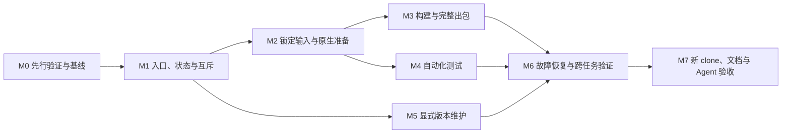

# 统一开发工具与一键开发出包——开发路线图

> 创建日期：2026-10-11
> 前置文档：[需求分析](requirement_analysis.md)、[技术设计](requirement_design.md)。
> 当前阶段：2026-10-11 用户授权按路线图实施；最新指示为完成 M2 后启动子代理 review、修复必要问题并暂停，不进入 M3。
> 总体状态：M0.1～M0.4 关键实验已完成，资源策略已形成实测草案；生产门禁尚未实现。M1 已完成并经子代理 review 修复；M2 已完成并经子代理复审通过；按用户要求暂停，M3～M7 未启动。

## 总览

交付一个位于 `scripts/dev_package/` 的统一工具，提供 check、build、test、package、version 和运行查询子命令。工具环境只检查，不安装；项目依赖按声明自动准备；默认交付未签名 App、ZIP、SHA-256 与构建记录。支持 Codex 和 Claude Code 通过仓库入口发现工具并准确判断结果。

版本操作禁止降级；`version increment` 等价于当前版本 patch 加 1，不改应用构建号，不被构建或出包隐式触发。skill 封装保持后置，当前工具仍依赖目标 checkout 的共用能力。

采用先验证、再实现、最后完整验收的顺序。M0 的环境声明与原生部署实验必须先形成证据，再实现相应检查和正式构建策略。可以独立完成不依赖这些结论的 CLI、状态协议或版本逻辑，但不能将假设写成已经验证的支持条件。

执行以子任务的具体依赖为准，图中的里程碑依赖用于说明主链路，不要求所有无关分支一起等待。默认一次认领一个最小任务；本文不要求多 Agent 并行实现。

## 里程碑

### M0 先行验证与基线

**目标**：消除会影响检查阈值、原生部署、测试范围与恢复策略的技术不确定性。实验使用当前 checkout 与声明输入，隔离实验输出，不修改系统工具或借用其他项目制品。

| 子任务 | 依赖 | 交付物 | 验收（可测） |
| --- | --- | --- | --- |
| ✅ **ST-M0.1** 核实工具与宿主支持条件 | — | 按任务区分的工具能力清单、Rust 最低经验证基线、完整 Xcode/CLT 支持表与证据 | 记录实际系统、工具、SDK、目标及验证命令；用当前声明工具执行 locked 构建/检查；区分供应方兼容、本项目实测和未验证，不自动安装任何工具 |
| ✅ **ST-M0.2** 验证原生部署目标与构建目录 | — | FFmpeg 13.0 部署实验、全部原生目标的传递策略、Sherpa staging/hash 检查与制品/编译树边界 | 隔离冷构建 FFmpeg，使用 `vtool`/`otool` 核对 minos；核对现有 Sherpa 固定哈希及路径归一化；变更目录不误复用编译树；保留旧成功制品 |
| ✅ **ST-M0.3** 测量准备与编译资源预算 | ST-M0.1、ST-M0.2 | 下载/解包/编译/交付阶段峰值与时间记录、集中磁盘策略 | 当前目录的锁定输入冷准备和构建过程中测量峰值，并计入 ZIP 与解压校验空间；依据证据给出余量及阶段复查规则，不凭估计设硬阈值 |
| ✅ **ST-M0.4** 审计测试完整性与进程恢复 | — | Rust 隐式 skip/ignored 清单、各测试结果适配实验、文件锁与硬中断实验 | 列出 FFmpeg 依赖和真实 Keychain 等排除项；缺依赖提前返回不得当作覆盖证据；验证结果格式可提取测试身份；用受控子进程实测父进程中断与锁存活，不杀无关进程 |

**出口条件**：上述结论能支撑后续确定行为；验证环境缺失标为 ⏸ 并说明所需条件。FFmpeg 部署修复需要 baseline 对齐，但不得在实验中放宽模型/Sherpa 哈希、质量规则或预算。

**完成记录（2026-10-11）**：见 [M0 实验报告](doc/m0/README.md)，原始命令/退出码/日志/采样保存在 `dist/dev-package/m0-20261011/`，报告中的可复核采集器与探针不是统一工具实现。

- **ST-M0.1 ✅**：macOS 26.6.2/arm64、CLT clang 21.0.0、SDK 26.5/25F70、CMake 4.4.2 精确匹配；选用本机已有 Node 24.19.0、pnpm 9.15.9。Rust 1.97.1 的 workspace locked/offline 检查、测试编译与 release 构建通过；依赖声明下限 1.88 未实测，支持表明确区分。Swift 6.3.3 强制 resolved versions 冷构建、自检及协议 smoke 通过；未安装工具。
- **ST-M0.2 ✅**：FFmpeg 显式 13.0 编译/链接/host 参数的隔离冷构建成功；发现父 Git 版本污染，阶段内隔离 Git 发现后两个独立目录的二进制哈希相同。Sherpa 新源码/编译路径冷构建 638.68 秒，三个核心制品与固定 manifest 的大小/hash 全部一致；staging 准备、最终制品 rename、原生 load/protocol smoke 通过，CMake 缓存搬迁被拒绝。实验 App 的七个 Mach-O 均 arm64/minos 13.0，489 项依赖许可证收集与 ZIP 解压一致性通过；不等于 macOS 13 实机业务验收。
- **ST-M0.4 ✅**：枚举 30 个 Rust 测试二进制/760 个用例/10 个 ignored，另枚举七个 crate 的 doctest（均 0）。stable Rust harness JSON 不可用；Vitest 172 项、typecheck、API 结果适配器七项通过；Python synthetic 身份/skip/failure 可提取。daemon FFmpeg 测试 40 项通过，但 normalizer 的 MP3 用例因随包无 libmp3lame 提前返回仍被计 passed；该缺口需要测试资产适配，不能计完整 unit 通过。五个受控进程实验验证了直接/多层锁继承差异与 SIGINT/SIGTERM；M1.4 必须收紧监督及残留进程门禁。
- **ST-M0.3 ✅**：已记录本轮本地准备/编译/App/ZIP/解压的耗时与采样。独立空输入目录的真实模型下载在 curl 600 秒总超时内只收到 76,511,628/163,002,883 字节，整个冷准备 820.37 秒后失败；小归档保留、半成品未发布。按用户建议已将现有下载总超时调整为 3600 秒，连接超时 30 秒，增加 120 秒低于 1 KiB/s 的低速退出条件；模型网络下载已完成并校验成功；随后 ONNX Runtime clone 触发独立 300 秒超时，因此将 Git 源码准备操作同步调整为 3600 秒，保留本地查询 300 秒上限。`cold-inputs-source-long-timeout` 复验通过（177.53 秒，退出码 0），完整核验归档、源码、子模块及许可证。冷输入树采样最大 944.43 MiB，最终 0.907 GiB；集中空间策略草案 `doc/m0/resource-policy.json` 采用实测值加 50% 余量、逐阶段向上取整，同卷合计预约 24 GiB，每个长阶段复查剩余预算。适用于本轮工具链、串行阶段和已有标准缓存；空全局缓存预算留给 M7 验证，生产磁盘门禁未实现。上一轮实验树最终 11.902 GiB 含调试测试、重复原生实验与交付副本，不能冒充 package 最低空间要求。

**保护核验**：上一轮结束时 630 个已跟踪业务/构建输入与 35 个原 FFmpeg/Sherpa 制品摘要均无变化；本轮按用户建议仅局部修改 `scripts/sherpa/fetch-inputs.py` 的下载超时，复核确认其他输入及原制品摘要不变（`input-protection-after-timeout.json`）；应用版本、质量规则、预算及 baseline 未更新。新 FFmpeg 的 API preflight 明确返回 `sherpa_ffmpeg_hash_mismatch`；未运行 acceptance 或改 baseline 绕过。M0 新发现的设计收紧建议见实验报告，未开展 M1 实现。

### M1 入口、状态与互斥

**目标**：建立可独立使用和测试的公共接口，让人和 Agent 能启动、检查、发现运行、查询结果并理解副作用。

| 子任务 | 依赖 | 交付物 | 验收（可测） |
| --- | --- | --- | --- |
| ✅ **ST-M1.1** 实现 Shell 引导与子命令解析 | — | `dev-package.sh`、Python 入口、公开帮助与参数契约测试 | 系统 Bash 3.2 可显示帮助；缺 Python/Node 时引导可解释；非法参数和不适用组合在写入前退出 2；无参数等价 package；未接入子命令明确返回不可用，不能空执行成功 |
| ✅ **ST-M1.2** 接入只读环境与输入检查 | ST-M1.1、ST-M0.1、ST-M0.3 | 共用 checks、集中策略、doctor 兼容入口、输入状态分类 | `check --json` 区分 ready/missing_preparable/invalid/unknown；合法缺输入不要求手动准备；缺工具/SDK 在下载前阻塞；检查无目录修改、无安装/切换工具副作用 |
| ✅ **ST-M1.3** 实现运行记录与结果协议 | ST-M1.1 | 原子 state/result、events、日志、schema v1 契约与退出码映射 | 通过标准库 JSON 解析并验证字段/状态；`--json` stdout 只有最终对象；运行开始即有结构化 stderr 通知；失败路径准确保留阶段和日志，目录不可写时不伪造路径 |
| ✅ **ST-M1.4** 实现仓库锁与受控子进程 | ST-M1.3、ST-M0.4 | process 管理、共享锁、进程身份与信号处理测试 | 两个修改任务并发时一个立即 busy/7；锁继承符合实测策略；SIGINT/SIGTERM 返回 130/143；硬中断不允许新任务与残留编译并发，不按名称查杀 |
| ✅ **ST-M1.5** 实现只读运行发现与查询 | ST-M1.3、ST-M1.4 | status、status --current、runs 及查询契约测试 | 按 operation/since/limit 查询；空列表、未知 ID、active/unknown 明确区分；通知丢失后仍能发现候选任务；不把最近任务当本次身份，不创建记录或恢复事务 |

**完成记录（2026-10-11）**：M1.1～M1.5 已实现；34 项标准库测试通过，真实 SIGINT/SIGTERM 及双重 SIGKILL 门禁有受控证据。完整 checkout 的只读检查使用已有 Node 24.19.0 返回 checked/ready_for_task；当前未接入 build 明确返回 unavailable/6。子代理 `review_m1` 两轮复核揭示并修复 shim 自动安装/空缓存初始化、结束瞬间信号竞态、损坏声明分类、FFmpeg 父路径 symlink、Sherpa 完成验证范围及管理器 metadata 类型问题；最后补充回归通过。证据及 review 修复记录见 [M1 记录](doc/m1/README.md)，原始输出 `dist/dev-package/m1-20261011/`。

### M2 锁定输入与原生准备

**目标**：使任务能在合格工具环境下自行准备项目输入；下载、校验、构建及发布各有明确阶段与恢复边界。

| 子任务 | 依赖 | 交付物 | 验收（可测） |
| --- | --- | --- | --- |
| ✅ **ST-M2.1** 接入前端、Cargo、Swift 依赖准备 | ST-M1.2～ST-M1.4 | 冻结依赖安装适配、任务依赖映射、OpenAPI 临时比较 | 空项目依赖可准备；pnpm frozen/Cargo locked/Swift resolved 强制生效；锁文件摘要前后一致；生成内容过期报告而不改源码；禁用交互与工具安装 |
| ✅ **ST-M2.2** 接入 Sherpa 输入与完整验证 | ST-M1.2～ST-M1.4 | 既有 fetch/verify 适配、来源与校验身份记录 | 缺输入自动获取；源码 revision/submodule/clean、归档大小/hash 和模型完整性照常验证；篡改/漂移非零，不改锁、不搜索其他 checkout |
| ✅ **ST-M2.3** 完成下载临时状态与网络恢复 | ST-M2.1、ST-M2.2 | 验证后发布下载、有限重试、所有权标记及下载恢复 | 注入超时、低速、坏哈希与中断；暂态最多三次有限重试，完整性错误立即停止；已验证输入保留，未知文件不清理；TLS 不降级 |
| ✅ **ST-M2.4** 迁移并修复 FFmpeg 默认构建 | ST-M0.2、ST-M1.4、ST-M2.3 | phases 中的真实实现、旧路径转发、13.0 部署配置与来源材料 | 冷构建 minos 不高于 13.0；输出 staging 验证后发布；许可证源码包包含真实实现与配置；旧缓存不符合部署要求时不复用，不删未知目录 |
| ✅ **ST-M2.5** 接入 Sherpa 构建与制品凭据 | ST-M0.2、ST-M2.2、ST-M1.4 | native build/prepare 适配、staging 发布、复用凭据 | 新编译结果满足既有 manifest/catalog/hash；凭据包含输入/工具/配置/脚本身份；不完整结果拒绝复用；只发布最终制品，不 rename 编译树后继续增量 |

**完成记录（2026-10-11，子代理复审通过后暂停）**：M2.1～M2.5 已完成。修复后真实准备运行 `20261011T113348867932Z-e88fc3258991` 为 checked/0：前端 frozen、OpenAPI 临时比对、Cargo locked、Swift force-resolved 和锁摘要保护通过；FFmpeg 冷构建哈希与 M0 一致、minos 13.0；Sherpa 冷构建满足原固定核心制品哈希和完整许可证验证。修复后运行 `20261011T114518779976Z-fe27be58ee6b` 为 checked/0，两类原生制品由当前完整凭据复用，无编译阶段。此前独立空源码/缺 VAD 实验验证真实 clone/download、坏归档与脏源码拒绝且保留。57 项工具测试通过，旧 35 项原生制品摘要不变。子代理 `review_m2` 发现并修复 FFmpeg 残留进程下的工作区清理、manifest 格式错误分类两项问题，复审通过；已增加真实中断/超时残留门禁与格式损坏回归。历史采集器和控制流失败记录保留。private runs 只覆盖 M2 preparation，不代表完整公共 build/package；M3 未启动，等待用户后续指示。详情见 [M2 记录](doc/m2/README.md)。

### M3 构建与完整出包

**目标**：交付 build/package 和 full 模式；现有专用脚本集中后只有一份实现，并保留必要的兼容入口。

| 子任务 | 依赖 | 交付物 | 验收（可测） |
| --- | --- | --- | --- |
| ⬜ **ST-M3.1** 接入前端、Rust、Swift 统一构建 | ST-M2.1、ST-M2.4、ST-M2.5 | release 构建阶段、helper 迁移、build 记录、旧 build 接口兼容 | `build --json` 构建当前源码并列出真实结果；Rust/Swift 只有一个完整构建责任方；旧 helper 入口与新实现一致；不组装假四项交付，不改业务源码或锁 |
| ⬜ **ST-M3.2** 实现 full 模式及复用规则 | ST-M3.1 | 全目标重建策略、编译目录归属和源身份记录 | `build --full` 对 Sherpa/FFmpeg/前端/Rust/Swift 均重新编译；有效下载输入和旧包保留；未知输出目录阻塞；输入变化拒绝成功，不能只清 Rust target |
| ⬜ **ST-M3.3** 接入 App 组装与全部资源验证 | ST-M3.1 | App 组装迁移、已验证构建输出接口、原生闭包及许可证检查 | 所有随包 Mach-O arm64、部署目标不高于 13.0；资源大小/hash、plist、动态库、许可证全部满足；probe/self-test 如实记录；不开 GUI、不申请 TCC |
| ⬜ **ST-M3.4** 发布完整交付与证据 | ST-M3.2、ST-M3.3、ST-M1.3 | ZIP、SHA256SUMS、build-record、完整目录原子发布 | `package --json` 和 `package --full` 均有四项完整交付；ZIP 解包后摘要/链接/模式一致；校验文件覆盖 ZIP/记录且无自引用；成功结果只指最终目录，历史包不覆盖 |

**完成记录**：尚无。整包验证与业务测试分别报告；出包成功不得描述为完整业务验收通过。

### M4 自动化测试

**目标**：test 子命令接入既有测试能力并准确聚合所选范围，不因隐式跳过、缺项或绿色组退出码产生假通过。

| 子任务 | 依赖 | 交付物 | 验收（可测） |
| --- | --- | --- | --- |
| ⬜ **ST-M4.1** 建立测试登记与结果适配 | ST-M0.4、ST-M1.3 | 必需/排除登记、Vitest/Python/Rust 适配器、格式契约测试 | 每个结果可关联测试身份；登记解释 ignored/隐式 skip；结果格式无法识别即 incomplete；Keychain/其他后端/付费 provider 明确 excluded，不能运行全部 ignored |
| ⬜ **ST-M4.2** 接入默认 unit 工作流 | ST-M4.1、ST-M2.1、ST-M2.4 | 前端 typecheck/Vitest、Cargo workspace、本工具测试与摘要 | `test` 与 `test --suite unit` 范围一致；无依赖自动准备；当前 checkout 的 FFMPEG_PATH 预检并显式传入；必需测试缺依赖不返回假绿，不回退系统 FFmpeg |
| ⬜ **ST-M4.3** 接入 API 前置依赖与部署修复基线 | ST-M0.2、ST-M2.4、ST-M2.5、ST-M4.1 | 完整锁定 Python 项目包、API frozen/locked 准备、FFmpeg baseline 受审更新及证据 | 使用已有 Python 安装到受管理包目录，不装新解释器/全局包/浏览器；新 FFmpeg 身份经冷构建复验并审查；其他质量规则/预算/Sherpa 哈希保持；运行命令不改基线 |
| ⬜ **ST-M4.4** 接入 integration/all 与结果聚合 | ST-M4.2、ST-M4.3 | quick/acceptance 适配、test-summary、下层安全报告关联 | `test --suite integration` 调既有 quick；all 执行 unit 和 acceptance，不重复其覆盖的 quick；真实 ASR/FFmpeg 指向当前 checkout；skip/missing/flaky/清理失败非零，不调用付费服务 |

**完成记录**：尚无。保存选定与实际范围、required/executed/excluded/missing、下层 run_id/退出码和报告路径；不复制受限原始证据。

### M5 显式版本维护

**目标**：在无 Cargo 依赖缓存的新 clone 中也可查看和更新应用版本，严格限制修改范围并保护未提交修改。

| 子任务 | 依赖 | 交付物 | 验收（可测） |
| --- | --- | --- | --- |
| ⬜ **ST-M5.1** 实现版本白名单结构检查 | ST-M1.1、ST-M1.3 | show/check、manifest/plist/本地锁条目解析、只读契约测试 | 无 Cargo/cache 可检查；三处应用声明及本地 seasnail-desktop 锁条目须一致；重复/远端/无法确定身份被拒绝；不以 no-deps metadata 零退出作为证明 |
| ⬜ **ST-M5.2** 实现版本计划与禁止降级 | ST-M5.1 | bump、increment、set 的共享计算、dry-run 和 no_change | `1.2.3 → 1.2.4`、`1.2.9 → 1.2.10`；minor/major 正确归零；set 不低于任何有效应用声明；相同一致版本不修改；预览零写入，不动 CFBundleVersion |
| ⬜ **ST-M5.3** 实现多文件版本事务 | ST-M5.2、ST-M1.4 | 备份/摘要/临时写入、事务提交、变更证据及日志 | 仅修改版本白名单与对应本地锁版本；结构与完整锁语义比较通过；第三方依赖、格式和无关修改保留；不下载依赖、不提交/tag/推送 |
| ⬜ **ST-M5.4** 接入事务恢复与其他任务门禁 | ST-M5.3、ST-M1.5 | 安全回滚/补记提交/冲突状态、未恢复事务阻塞 | 对逐文件失败及提交前后中断注入；用户修改冲突不覆盖；恢复不执行第二次 increment；已提交事务不能借恢复降级；build/test/package 不用混合版本 |

**完成记录**：尚无。版本测试在隔离仓库副本执行，不改当前真实版本；证据明确结构检查和完整依赖解析的执行范围。

### M6 故障恢复与跨任务验证

**目标**：将阶段内验证组合为真实工作流验证，证明同一入口重跑可靠、任务互斥有效、交付与状态一致。

| 子任务 | 依赖 | 交付物 | 验收（可测） |
| --- | --- | --- | --- |
| ⬜ **ST-M6.1** 验证下载、编译与组装中断恢复 | ST-M2.3、ST-M3.4 | 分阶段故障注入、自有 staging 恢复与重跑证据 | 网络中断、原生编译中断、App/ZIP 中断后使用同入口完成；不复用半成品；只清可证明自有状态，旧包摘要不变 |
| ⬜ **ST-M6.2** 验证发布、空间与完整性失败 | ST-M3.4、ST-M4.4 | 发布后结果补写、空间/权限/篡改故障证据 | 发布后结果写入前中断能识别已提交交付；不可写/低空间/错误hash/许可证缺失非零，失败 artifacts 不指 staging，不更新基线 |
| ⬜ **ST-M6.3** 验证增量、全量和当前源码 | ST-M3.2、ST-M3.4、ST-M4.4 | 重跑与源码变更验证、目标复用说明 | 增量构建反映源码修改；full 全目标重建；输入在运行中变化拒绝成功；多个成功运行独立交付，不覆盖旧目录；锁文件保持 |
| ⬜ **ST-M6.4** 验证跨任务互斥与断连 | ST-M5.4、ST-M1.5、ST-M4.4、ST-M3.4 | build/test/package/version 并发与硬中断、运行发现证据 | 一次只允许一个修改任务；只读 status/runs 可用；锁活跃与历史状态不混淆；通知前后断连、多候选与版本提交丢失结果不会导致重复递增或误杀 |

**完成记录**：尚无。故障用受控测试设施注入，不制造真实磁盘耗尽，不修改开发者文件或系统权限。

### M7 新 clone、文档与 Agent 验收

**目标**：证明新开发者仅凭仓库公开入口即可使用工具，并交付完整可追溯的 MVP 验收记录。

| 子任务 | 依赖 | 交付物 | 验收（可测） |
| --- | --- | --- | --- |
| ⬜ **ST-M7.1** 完成统一说明与仓库发现入口 | ST-M3.4、ST-M4.4、ST-M5.4 | doc/dev-package.md、目录 README、根 README 中英文、AGENTS.md/CLAUDE.md、旧教程更新 | 命令/帮助/JSON/支持表与实际一致；CLAUDE.md 引用共享指引；没有多套业务规则或插件前提；旧兼容入口有效；链接与 `git diff --check` 通过 |
| ⬜ **ST-M7.2** 完成独立新 clone 验收 | ST-M6.1～ST-M6.4、ST-M7.1 | 冷准备/冷出包、缺工具隔离、test 范围及版本操作证据 | 新 clone 无项目制品并指定空标准下载缓存；仅用已有合格工具与声明上游，一条 package 命令完成四项交付；另测缺工具提示、unit/integration/all 和无 Cargo/cache 的版本操作 |
| ⬜ **ST-M7.3** 完成 Codex 与 Claude Code 使用验收 | ST-M7.2 | 两工具独立新会话的发现、调用、失败判断与交付记录 | 记录实际版本、指引加载方式、初始任务和调用；不提供内部命令/实现知识；环境合格正常路径零人工阶段串联；另测 README 引导、网络/权限/hash 阻塞和准确交付 |
| ⬜ **ST-M7.4** 汇总 MVP 验收与迁移结论 | ST-M7.2、ST-M7.3 | AC-01～32 完整矩阵、剩余限制、最终验证索引和推荐入口切换 | 每条 AC 关联本次证据/任务；缺项或条件不足不计通过；准确区分出包、自动测试与人工业务验收；只有全部范围内任务完成才报告 MVP 完成 |

**完成记录**：尚无。真实系统交互、工具安装或 Agent 权限审批按实际记为外部处理；不得伪装为工具自主完成。

## 横切关注点

| 关注点 | 落点与规则 |
| --- | --- |
| 源码与锁保护 | M2/M3/M5/M6；普通任务不写业务源码或锁，版本仅为白名单例外；运行中输入变化有明确终态 |
| 架构与部署目标 | M0.2、M2.4、M3.3；所有随包原生依赖满足 arm64/13.0，不以 plist 代替实际二进制检查；目标系统实机证据缺失如实标记，不宣称完整旧系统业务回归 |
| 复现与基线 | M2.5、M4.3；Sherpa 哈希不放宽；FFmpeg 部署修复的 baseline 通过开发审查与证据更新，运行命令不能改基线 |
| 非交互与权限 | 所有任务；不 sudo、不改 shell/global 配置、不安装工具、不绕过 Agent 沙箱；错误不无限等待 |
| 日志与隐私 | M1.3、M4.4、M5.3；不打印环境全集/凭据，不读取账户/钥匙串；测试原始受限材料不复制到普通构建日志 |
| 目录与兼容 | M2.4、M3.1/M3.3、M7.1；新实现集中 scripts/dev_package，旧路径薄转发，共用资源保持单一来源；对应源码材料引用真实实现 |
| 完整性与状态 | M1/M4/M6；成功必须有证据，未知、缺项、skip、flaky 不被旧结果或局部绿色覆盖 |
| 修改任务互斥 | M1.4、M5.4、M6.4；同 checkout 共享锁，查询只读；已有独立底层入口未参与锁时不承诺可安全与新流程并发 |

## 风险与去风险验证

| 风险 | 最早验证任务 | 验收/预案 |
| --- | --- | --- |
| 宿主/Rust/空间阈值未知 | ST-M0.1、ST-M0.3 | 形成实测支持策略后才实现硬检查；无相应条件标 ⏸，不编造通过 |
| FFmpeg minos 26.0 | ST-M0.2 | 实验显式传递 13.0 编译/链接；不满足时阻止对应正式构建接入，不改运行承诺 |
| 原生制品身份或测试 baseline 漂移 | ST-M0.2、ST-M4.3 | 同源冷构建与路径验证，保留诊断；只进行已设计的受审 FFmpeg 修复基线更新，其他漂移先调查 |
| Rust 隐式 skip 与结果格式 | ST-M0.4、ST-M4.1 | 登记依赖/排除，格式无法识别返回不完整，不能组退出 0 就通过 |
| 父进程死亡但子进程仍在构建 | ST-M0.4、ST-M1.4 | 实测锁继承和身份核验；不能证明归属时阻塞而非查杀 |
| 多文件版本事务失败 | ST-M5.3、ST-M5.4 | 持久证据、逐文件注入、摘要保护；冲突保留，恢复不重复自增 |
| 断连导致运行 ID 丢失 | ST-M1.5、ST-M6.4 | 提前通知与公开候选查询，无法唯一确认时如实报告，不盲用最近运行 |
| Agent 发现方式随版本变化 | ST-M7.3 | 记录版本和加载证据，验证轻量入口与 README 兜底，不以插件补前置 |

## 验收覆盖

| 需求验收 | 主要实施/验证任务 |
| --- | --- |
| AC-01 | ST-M7.2 |
| AC-02、03、17 | ST-M0.1、ST-M1.2、ST-M7.2 |
| AC-04 | ST-M2.3、ST-M6.1 |
| AC-05 | ST-M2.5、ST-M6.1 |
| AC-06 | ST-M3.2、ST-M6.3 |
| AC-07 | ST-M2.2、ST-M6.2 |
| AC-08 | ST-M1.2、ST-M6.2 |
| AC-09 | ST-M3.3、ST-M3.4 |
| AC-10、11、12、13 | ST-M7.1、ST-M7.3 |
| AC-14、26 | ST-M1.4、ST-M6.4 |
| AC-15 | ST-M1.3、ST-M3.4、ST-M4.4、ST-M5.3、ST-M7.3 |
| AC-16 | ST-M2.4、ST-M3.1、ST-M3.3、ST-M7.1 |
| AC-18 | ST-M1.1、ST-M5.1 |
| AC-19 | ST-M3.2、ST-M6.3 |
| AC-20 | ST-M4.2 |
| AC-21、22 | ST-M4.3、ST-M4.4 |
| AC-23、27、32 | ST-M5.1、ST-M5.2、ST-M5.3 |
| AC-24、25 | ST-M5.4、ST-M6.4 |
| AC-28 | ST-M1.2、ST-M2.2 |
| AC-29 | ST-M1.5、ST-M6.4 |
| AC-30 | ST-M0.4、ST-M4.1、ST-M4.2 |
| AC-31 | ST-M0.2、ST-M2.4、ST-M3.3、ST-M4.3 |

## 后置项

- skill 打包/安装、仓库外独立工具分发、更多 Agent 厂商适配。
- 签名、公证、正式发行、上传、安装到 Applications。
- 工具链自动安装/切换、自动系统授权、其他平台与后端。
- 人工桌面与真实账户/付费 provider 验收、新测试体系。
- 预发布版本、应用构建号自动递增、独立组件发版、自动 commit/tag/push。
- 云端构建、CI 改造、离线首装及固定构建耗时承诺。

## 进度跟踪

| 产物/里程碑 | 状态 | 最近验证 | 备注 |
| --- | --- | --- | --- |
| 需求分析 | 已确认范围 | 文档编号与本地引用检查 | 不代表实现完成 |
| 技术设计 | 作为本路线图依据 | 审查问题已纳入设计 | 环境与兼容性须在 M0 实测 |
| 本路线图 | M1～M7 已获实施授权 | 2026-10-11 | 每个里程碑必须经子代理 review |
| M0 先行验证 | ✅ 关键实验完成 | 2026-10-11，见 M0 报告 | 1～4 实验完成；空间策略为实测草案，生产门禁及 M7 空全局缓存复验未实施 |
| M1 入口与状态 | ✅ | 2026-10-11，34 项测试及子代理 review | 问题已修复，详情见 M1 记录 |
| M2 输入与原生准备 | ✅ | 2026-10-11，57 项测试、修复后真实原生准备/凭据复用及子代理复审 | 两项必要问题已修复；按用户要求暂停，M3 未启动 |
| M3 构建与出包 | ⬜ | — | 四项完整交付 |
| M4 自动化测试 | ⬜ | — | 无假绿或隐藏缺项 |
| M5 版本维护 | ⬜ | — | 禁止降级、显式自增 |
| M6 恢复验证 | ⬜ | — | 故障证据不可由单测替代 |
| M7 新 clone 与 Agent 验收 | ⬜ | — | AC-01～32 逐项追溯 |

## 执行与更新规则

1. 计划获准实施后，每次继续工作先读需求、设计和本路线图；选择依赖满足的一个最小任务，开始时改为 🚧。
2. 执行相称验证，通过后才改为 ✅；完成记录包含日期、实际命令/环境、证据路径及必要偏差。模型或原生步骤不因 stub 测试通过就标真实集成完成。
3. 缺系统工具、目标环境、权限或其他条件时标为 ⏸，写明原因和恢复条件；可以推进不依赖该结论的任务，不能跳过门禁。
4. 验证推翻设计假设时，先提出具体变更并更新获确认的设计依据，再调整任务；不能改测试断言、质量预算或基线掩盖实现偏差。
5. 每个任务保持可独立复核的变更与证据，完成小任务后及时更新路线图。自动提交、推送与发布不属于本计划授权。
6. 需求范围内任务全部 ✅，或经用户明确同意后置/取消，且完整验收矩阵有证据，才能报告 MVP 完成；文档完成、局部出包或某个 Agent 成功不足以替代。

本计划不承诺日历工期。先行验证后可按实际下载/编译耗时与外部条件补充排期；长构建过程记录耗时，不因此削减验收范围。
